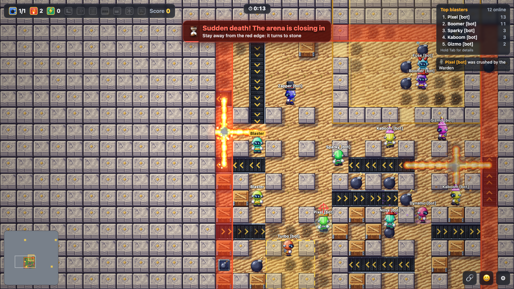
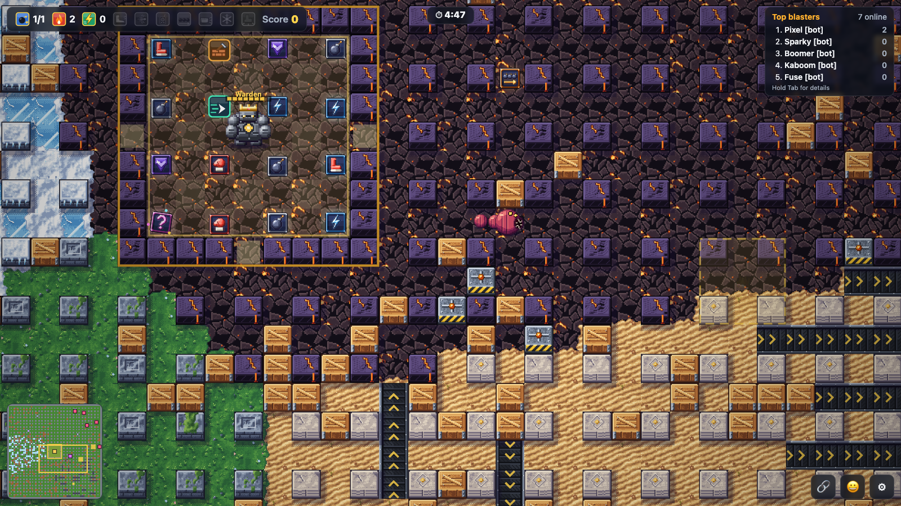
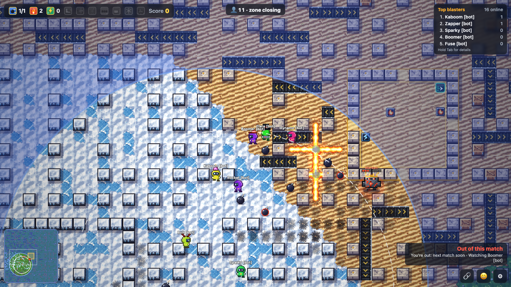
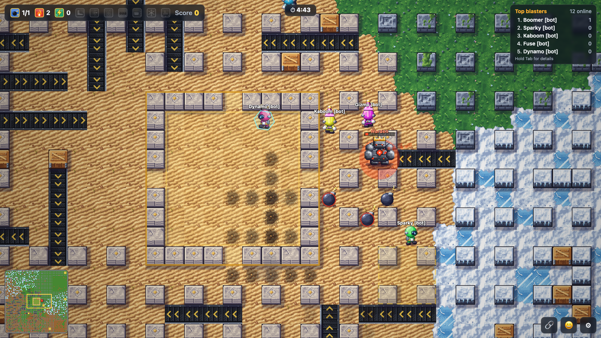
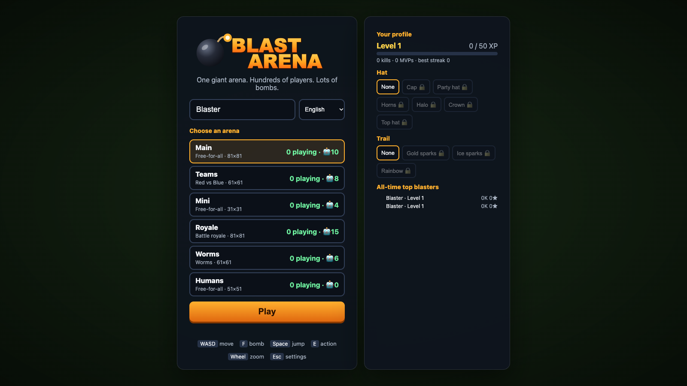

# Blast Arena

A massively multiplayer bomb-maze game for the browser. Pick an arena, drop bombs, blast crates, grab power-ups, hold the hills and blast each other.



| | |
|---|---|
|  |  |
| **Worms:** giant worms hunt everyone along the lanes. | **Battle royale:** the safe zone shrinks; the blue storm hurts. |
|  |  |
| **The vault and its Warden** in the Teams arena, among snow, desert and conveyor belts. | **The lobby:** pick an arena, see your level and unlock hats and trails. |

- **Server:** Rust (Axum + WebSocket). Several arenas run side by side, with smart AI bots, rounds, teams and persistent player profiles in redb (a pure-Rust embedded database).
- **Client:** TypeScript on a plain HTML5 canvas (no framework, no bundler) with pixel art generated in code (or the classic hand-made SVG art) and procedural chiptune music (no audio files), in English, German, French, Spanish, Italian, Polish and Ukrainian. The language follows your browser and can be changed in the lobby or settings.

## Run

You need [Rust](https://rustup.rs) 1.88 or newer and [Deno](https://deno.com) 2.9 or newer (2.9.8 is what Docker and the release builds use). Deno runs the client's build tools (esbuild, Sass, Lightning CSS, TypeScript, ESLint) from npm; there is no Node.js or npm step.

```bash
deno install && deno task build   # build the client (client/) into static/js and static/style.css
cargo run --release
```

Open http://localhost:3000, pick an arena, enter a nickname and play.

The live server dashboard is at http://localhost:3000/dashboard.html, and Prometheus metrics at `/metrics`.

The release build embeds the compiled client in the binary, so `target/release/blast-arena` runs on its own. If you skip `deno task build`, `cargo build` stops and tells you to run it.

### Development

```bash
deno task watch   # rebuild the client on every save (readable, with source maps)
cargo run       # debug server: serves static/ from disk, so a reload picks up client changes
```

| Command | What it does |
|---|---|
| `deno task build` | Production client: [esbuild](https://esbuild.github.io) bundles and minifies the TypeScript into one file per page (`static/js/main.js` for the game, plus `dashboard.js` and `tilelab.js`), and the SCSS in `client/styles/` is compiled by [Sass](https://sass-lang.com), its media queries merged, and minified by [Lightning CSS](https://lightningcss.dev) into `static/style.css` |
| `deno task build:dev` | The same, readable and with source maps |
| `deno run -A scripts/build-client.mjs --targets` | Shows the browser targets and how much of global usage they cover |
| `deno task check` | Type-checks the client (strict, with `tsc`) and lints it (ESLint with typescript-eslint's strict rules); the bundler only strips types |
| `deno audit` | Checks the client's build dependencies for known vulnerabilities |
| `cargo test` | Server tests (game rules, protocol, abilities, worms, the Warden, map generation) |
| `cargo test --no-default-features` | The same without WebTransport: 118 crates to compile instead of 200, for faster clean builds; such a server serves everyone over the WebSocket |
| `cargo clippy --all-targets` | Rust lints |

**Dependencies.** `deno.json` lists the build tools as `npm:` packages and `deno.lock` pins them; `deno install` puts them in `node_modules/` (ESLint and TypeScript look for plugins there). Deno skips packages published in the last 24 hours (a supply-chain safeguard), and runs no install scripts: esbuild and Lightning CSS don't need theirs, and the file-watcher add-on Sass can use is left unbuilt, so `deno install` reports it as ignored. `deno audit` currently reports one moderate advisory, in the `minimatch` that ESLint itself depends on (a slow pattern on hostile glob patterns). It only ever sees this repository's own lint settings and none of it ships in the game; Deno can't force a different version of a dependency's dependency, so it clears when ESLint moves to minimatch 11.

**Browser support.** The client is built for the browsers in `.browserslistrc` (`cover 95%, not dead`): about 95% of global usage, including Chrome 103+, Firefox 115+, Safari and iOS Safari 15.6+, Samsung Internet, and UC and QQ Browser (built on older Chromium, so the JavaScript targets Chrome 78). esbuild rewrites newer syntax for them, Lightning CSS adds vendor prefixes and fallbacks, and the lint step (`eslint-plugin-compat`) flags browser APIs they lack. The game needs WebSockets, canvas and ES modules, so Internet Explorer is out.

Open the game with `?debug` to get `window.__blast` (state, predictor stats, network) in the browser console. The Tile Lab (below) previews the pixel art.

### Controls

| Input | Action |
|---|---|
| WASD / arrow keys | Move. Hold a second direction to queue a turn: hold Right, press Up early, and you turn at the next gap. |
| F / Enter | Drop a bomb. Press again while standing on it with the line bomb to lay a row. |
| Space | Jump over the stone pillar in front of you into the free cell behind it (0.4 s hop, 0.5 s cooldown; hold to keep hopping). You're above the fire while airborne, but can't steer, and a bomb pressed mid-air drops on landing. Crates and the map border can't be jumped. |
| E / Shift | Action: detonate remote bombs, or punch the bomb in front of you |
| Q | Use your gadget (land mine, rocket, swap, drone, drone swarm) |
| R | Use your ability (builder wall, clone, portal pair: press twice, dash) |
| C (hold) | Shake off a sticky bomb stuck on you (0.8 s) |
| X | Cancel a half-placed portal pair |
| 1–8 | Emotes (also the 😀 button) |
| Mouse wheel, `+` / `-` / `0` | Zoom in / out / reset |
| Tab (hold) | Leaderboard with kills and deaths |
| M / P / N / Esc | Mute / FPS / minimap / settings |
| Gamepad | Stick or d-pad moves, A bomb, B gadget, Y jump, X action, shoulder buttons zoom, right trigger ability, left trigger (hold) shake off a sticky bomb |
| Touch | Drag on the left to steer (floating joystick), bomb, jump (⤒), gadget (Q), ability (R) and action buttons, ✋ (hold, while a sticky bomb is on you), pinch to zoom |

The settings menu has music and sound volume, zoom, language, **art style**, mute, FPS, a colour-blind-friendly palette, high contrast, and a button to replay the tutorial. Art style is **Pixel art** by default: crisp 16×16 graphics generated in code, tiles in `client/pixelart/` and sprites in `client/pixelsprites/`, sharing `client/pixelkit.ts`. **Classic** brings back the original vector art.

**How to play** is a short illustrated tutorial: 17 slides, each a picture drawn with the game's own pixel art (a blast cross, a hop over a pillar, every power-up token) and a sentence or two, covering moving, bombs, jumping, power-ups, gadgets and abilities, the arena, dangers, the modes and scoring. It opens the first time you press Play (before you join, so nothing can hit you while you read), from the lobby's **How to play** button, and from settings. Next/Back, the dots, the arrow keys or a swipe turn the pages; Esc closes it.

The pixel art follows a few rules:
- **Lighting:** one light source from the top left, and colour ramps that shift hue (cool shadows, warm highlights).
- **Floors:** quiet and seamless, with variants per region, so players and items stand out.
- **Walls and crates:** raised blocks in 3/4 view, casting soft shadows onto the floor.
- **Regions:** each has its own walls (mossy stone, snow-capped blocks with icicles, limestone with gold inlays, obsidian with lava veins), and neighbouring regions blend along a wavy border.
- **Sprites:** everything you interact with has a dark outline.
  - **Bombs:** shaded iron spheres with a glint and a ground shadow. Pierce bombs are red with spikes, and remote bombs get a blinking antenna.
  - **Fire:** a fireball with white-hot, yellow, orange and red bands, flickering through three frames.
  - **Power-ups:** one family of bevelled tokens. The frame colour shows rarity and the glyph shows the effect.
  - **Players:** helmeted bombers in their team or player colour, with walk frames and pixel hats.
  - **Particles:** in pixel style they snap to the same pixel grid.

The **Tile Lab** at http://localhost:3000/tiles.html has three parts:
- a live scene animated by the game's renderer: walking players with hats, all three bomb types, a flickering explosion and power-ups
- a sample map of all four regions
- a sheet of every generated tile and sprite

You can reroll the tile seed there and compare with the classic art.

## Configuration

Command-line arguments; each has an environment-variable fallback. `cargo run --release -- --help` lists them.

| Argument | Env var | Default | Meaning |
|---|---|---|---|
| `--port` | `PORT` | `3000` | HTTP/WebSocket port |
| `--wt-port` | `WT_PORT` | same as `--port` | UDP port for WebTransport (see [Transports](#transports)); `0` turns it off |
| `--wt-public-port` | `WT_PUBLIC_PORT` | `--wt-port` | The UDP port browsers connect to, when a port mapping changes it (Docker Compose maps 443 to 3000) |
| `--wt-cert`, `--wt-key` | `WT_CERT`, `WT_KEY` | self-signed | PEM certificate chain and key for WebTransport, reloaded when the file changes. Without them the server makes a 13-day self-signed certificate, renews it every 6 days, and browsers accept it by its SHA-256 hash. |
| `--arena` | `ARENAS` | see below | An arena as `NAME:MODE:SIZE:BOTS`, mode `ffa`, `teams`, `royale`, `worms`, `rockets`, `dungeon` or `cosmos`. Repeat the flag, or comma-separate in the env var. |
| `--map-size` | `MAP_SIZE` | `81` | Size of the default main arena |
| `--bots` | `BOTS` | `10` | Bots in the default main arena |
| `--max-players` | `MAX_PLAYERS` | `256` | Player cap per arena, bots included (raised to fit an arena's bots) |
| `--round-secs` | `ROUND_SECS` | `300` | Round length |
| `--map-seed` | `MAP_SEED` | random | Seed for the map layouts. Each start picks a fresh one and logs it; pass it back to replay the same maps (with the same arenas). |
| `--db` | `DB_PATH` | `blast.redb` | redb database file for profiles; `""` disables them |
| `--abilities` | `ABILITIES_CONFIG` | built in | JSON tuning of the six ability power-ups (charges, cooldowns, durations, radii, switches). Fields left out keep their defaults; `config/abilities.json` lists them all. An invalid file stops the server. |
| `--static-dir` | `STATIC_DIR` | built in | Serve the client from a directory instead. Release builds embed `static/` in the binary, so the executable runs on its own; debug builds serve `static/` from the source tree, so client edits show up on reload (keep `deno task watch` running to recompile the TypeScript). |
| `--public-url` | `PUBLIC_URL` | from the request | The site's public address (e.g. `https://blastarena.fun`) for link previews, the canonical link, `robots.txt` and `sitemap.xml`. Without it the address comes from each request (`Host`, or a proxy's `X-Forwarded-Proto` and `X-Forwarded-Host`). |
| `--log-level` | `LOG_LEVEL` | `info` | Log filter: a level plus `target=level` pairs, e.g. `debug` or `info,blast_arena::net=debug`. `RUST_LOG` overrides it. |
| `--log-format` | `LOG_FORMAT` | `compact` | `compact`, `pretty`, or `json` (one object per line, for log collectors) |

Without `--arena` the server runs ten arenas:
- `Main:ffa:<map-size>:<bots>`
- `Teams:teams:61:8`
- `Mini:ffa:31:4`
- `Royale:royale:81:15`
- `Worms:worms:61:6` (free-for-all with hunting worms)
- `Rockets:rockets:51:8` (free-for-all where the bomb key fires rockets)
- `Dungeon:dungeon:61:6` (rooms and corridors haunted by monsters)
- `Horde:ffa:321:1000` (a free-for-all with a thousand bots, about 100 cells each; an arena's player limit is raised to fit its bots, and a joining human takes a bot's place)
- `Humans:ffa:51:0` (no bots: real players only)
- `Cosmos:cosmos:51:8` (a space station where the bomb key fires colored blasters; last in the list so the other arenas keep their ids)

Every start generates new maps. Each arena rolls its own layout from the map seed: a pillar pattern (classic grid, checkerboard, scattered, rooms of joined walls, open plazas, a winding maze with loops, or concentric rings with gates), optional mirror or rotational symmetry (walls, crates and spawn pockets alike, so no side is favoured), patchy crate cover, region placement, and how much ice, armour, conveyor belt and teleporting there is. The generator builds three candidate layouts and keeps the best by a quality score: spawn points spread over the whole arena, crates balanced between the quarters, few dead ends. The log shows the seed and a summary of each map with its score (`map generated`). To preview layouts without starting a server, run `cargo run --release --bin mapview -- --size 41 --count 5` (add `--open` for battle royale maps, `--dungeon` for dungeon maps, `--space` for cosmos maps). Whatever the roll, the border is solid, no open cell is walled off, teleport pads come in pairs and there are plenty of safe spawn spots.

### Logging

The server logs with `tracing`. Records from the `log` crate are bridged into the same output, and the profile database logs that way.

| Level | Events |
|---|---|
| info | Startup and arena config; each player's join and disconnect, with the reason, duration and message counts; reconnects that resume a parked player; round results; tick stats every 10 s; shutdown |
| warn | Rate-limited or too-slow clients; dropped profile saves |
| debug | Handshake failures, socket errors, bot top-ups, profile loads and saves, and HTTP requests with their latency (`tower_http=debug`) |

Each session's lines carry a span with the arena, the peer address and the player id. Each game line carries its arena. Profile tokens are never logged.

```bash
RUST_LOG=info,blast_arena=debug cargo run --release -- --log-format json
```

## Gameplay

- **Bombs** explode in a cross after 2.5 s. Pillars stop the blast. Crates absorb it and break. Blasts set off other bombs in chain reactions.
- **Map regions**, each with its own look. Maps of 41×41 and up mix four to seven regions placed at random; smaller maps get a single random theme:

  | Region | Feature |
  |---|---|
  | Snow | Ice: let go and you keep sliding until you steer, hit something or leave the ice |
  | Desert | Conveyor belts that carry players and bombs |
  | Volcano | Armored crates that take two blasts |
  | Grass | Normal arena |

  Linked teleporter pads connect distant parts of the map.
- **Power-ups**, revealed from 25% of crates:

  | Power-up | Effect |
  |---|---|
  | +bomb | One more bomb at a time |
  | +range | Longer blast |
  | speed | Move faster |
  | kick | Walk into a bomb to send it sliding |
  | shield | 6 s of invulnerability |
  | pierce | Your blasts go through crates |
  | full fire | Maximum range |
  | remote | Your bombs wait for E (or 10 s) |
  | line bomb | Lay a row of bombs |
  | punch | Throw a bomb over obstacles |
  | ghost | Walk through crates for 6 s |
  | **atomic bomb** | Rare (1%). Your next bomb is a nuke: a 3.5 s fuse, then a shockwave that burns a disc of radius 6 over a few ticks. Pillars give no cover; crates (armored too) and items are vaporized. While it ticks, every cell it will burn is shown in red with a countdown, also on the minimap |
  | freeze | Your blasts leave ice on the floor for 8 s |
  | stomp | Landing a jump next to enemies stuns them for 1 s (no moving, jumping or bombs) |
  | **secret box** | A random outcome when opened (see below) |

- **Gadgets** are one-shot items used with **Q** (gamepad B). You hold the last kind you picked up, with a charge count in the HUD:

  | Gadget | Effect |
  |---|---|
  | land mines ×3 | Hidden from enemies (your team sees them). An enemy next to one sets it off half a second later; fire sets it off at once. |
  | rockets ×3 | Flies straight ahead at 20 tiles/s and explodes on whatever it hits |
  | swap ×2 | Trade places with the nearest enemy within 6 tiles |
  | drone | Flies over walls to the nearest enemy and drops up to 3 bombs on them |
  | drone swarm (1%) | Five drones, one bomb each, spreading over different enemies |

  Gadget bombs don't count against your bomb limit.

- **Abilities.** Four active abilities used with **R**: you hold one (another kind replaces it), with a few charges that come back one per cooldown. Two **bomb modifiers** change your next bombs (gas or sticky, never both). All of it is tuned in `config/abilities.json` (see `docs/ABILITIES.md`):

  | Ability | Effect |
  |---|---|
  | builder | A wall in the cell in front of you for 6 s (2 charges, 8 s cooldown, at most 2 standing). It blocks everyone (ghosts too), blasts and gas; a blast breaks it but stops there, a piercing one goes through. |
  | gas bombs ×2 | Instead of fire, a cross of gas (radius 2) for 4 s: 30% slower inside and for 0.5 s after; the screen edges go green. Fire touching the gas ignites it once: everyone in the cloud is hit by one burst. |
  | clone | A decoy that looks exactly like you replays your moves from 2 s ago for 5 s, fake bombs included (18 s cooldown). It can't hurt or pick anything up; a blast destroys it. You see a dashed ring under it. |
  | sticky bombs ×2 | Thrown 2 cells ahead; it sticks to the first enemy it touches (in flight or later on the ground) and rides along until its 3 s fuse runs out, through portals too. Hold **C** for 0.8 s to shake it off. |
  | portal pair | Press R to place a portal up to 3 cells ahead, again for its partner (5 s to do so). Players and sliding bombs go through, keeping direction; fire and gas don't. 12 s, then 20 s cooldown. A blocked exit refuses the trip. |
  | dash | 2.5 cells in 0.2 s in the direction you hold (6 s cooldown). Stops at walls and bombs, gives no protection from fire on the way, and may take one portal. |

- **Secret box.** Opening it gives one of:
  - any power-up
  - a jackpot: +1 bomb, +1 range and +1 speed
  - a curse: slowed down, no bombs, or reversed controls
  - bomb rain around you

  Secret boxes also appear on their own around the map.
- **Rounds** last 5 minutes. At the end, the MVPs and the winning team are shown, the MVP's profile gets a win and bonus XP, and scores reset. When the first human joins an arena where only bots are playing, the round starts over from the beginning (in battle royale, a new match), so they never land in the last minute of a bots' round.
- **Sudden death** fills the last minute of every round: the arena closes in, one ring at a time, towards a random centre. Rings never close faster than you can walk, so on very big maps the arena doesn't close all the way. The next ring to close glows red; whoever is still in it when it turns to stone is crushed. Jumping over the closing wall at the last moment works. The arena reopens for the next round.
- **Map events** every minute or two: a **meteor shower** (marked impact zones, then blasts), a **blizzard** in snowy maps (everyone slows down, the minimap fogs over), a **lava surge** in volcanic regions (the ground glows, then burns), an **earthquake** in volcanic regions (the screen rumbles; fissures of fire open along volcano lanes after a short warning; tremors jolt resting bombs a cell in a random direction; when it stops a third of the volcano's crates break and may drop power-ups, some armor cracks and a few pillars crumble into rubble until the next round) and **reversed conveyors** in the desert.
- **Capture the flag** in the Teams arena: each team has a flag at its base. Walk over the enemy flag to take it and bring it to your base while your own flag is home: +5 points. Carriers can't jump or drop bombs. A carrier who dies drops the flag; touching your own dropped flag sends it home, and it goes home by itself after 15 s. You respawn near your base.
- **Dungeon** (the Dungeon arena): a free-for-all in rooms full of crates joined by narrow, winding corridors of dark brick, with the Warden's vault in the middle. Monsters roam it and hunt anyone near: **slimes** ooze slowly and never see a bomb coming, **skeletons** take two blasts, march nearly as fast as you walk and dodge fire, and **bats** flutter over crates and bombs, erratic and a little slower than you. In the dungeon you have three hearts (shown in the HUD): a monster's bite takes one, the last one kills. After a bite you blink for 2 s: monsters can't bite you and lose interest, and the one that bit you staggers, so you can get away. Hearts come back one every 8 s without a bite (and all at once from a **Heart** power-up, dropped only here, by crates now and then and often by slain monsters), and until then you leave a trail of blood as you walk; bombs still kill in one go. Blowing one up scores (+1, +2 for a skeleton) and may leave a power-up; new monsters climb out of the ground away from players, harmless while they rise. Bots avoid and hunt them too.
- **Battle royale** (the Royale arena): last player standing. Everyone starts spread over an open map and the whole map is safe; then the safe zone shrinks in five phases. Each phase first shows the next, smaller circle (white dashed line, also on the minimap) for a while, then the zone closes in on it. Outside the zone is the blue storm: the HUD shows how long you can stay in it (5 s early on, down to 1 s at the end), and time inside lets you recover. No respawns during a match: you watch the nearest survivor, and a new match starts 6 s after a winner is decided (+5 points), with everyone back and power-ups reset. Joining is open until the zone first moves. Royale maps are built to be run across: fewer crates, a crate-free road every 8 cells, and no pocket that can't be walked out of.
- **Worms** (the Worms arena): a free-for-all where giant worms crawl the lanes and hunt everyone, bots included. A worm is a head and a body that follows the head's path; it smells players up to 12 steps away along the lanes and crawls after the nearest one (yellow eyes while roaming, red while hunting, slower than you on foot). Touching any part of a worm on the ground eats you, unless you are shielded or jumping over it, and makes the worm a segment longer. Fire destroys the segments it touches: the end with the head crawls on, a cut-off piece of two or more segments becomes a worm of its own, and a worm that loses its head or is left too short dies. Ending a worm scores +1 for whoever's fire did it. New worms burrow out of the ground (a trembling mound, harmless for a second) away from players, about one per 550 cells of map. The minimap shows every worm. Worms maps are open, like Royale's, so worms and players have room to move. All the numbers are in `WormTuning` in `src/game/worms.rs`.
- **Rockets** (the Rockets arena): a free-for-all where nobody drops bombs. The bomb key fires a rocket the way you are walking, or facing when you stand still. It flies a cell every tick and blows up on whatever it hits first: a player (in their cell), a wall, a crate or a bomb, or after 3 s in the air. The blast is a cross of your bomb range (at least 2) and never hurts you; pierce and freeze power-ups carry over. Rockets in the air count towards your bomb limit, so extra bombs mean faster fire. Atomic, gas, sticky, line and remote bombs don't apply. Bots shoot down open lanes at enemies and at crates nearby, and step out of the lane of an incoming rocket.
- **Cosmos** (the Cosmos arena): a free-for-all on a space station (starfield deck plates, hull blocks with running lights, extra warp pads, long lanes to shoot down) where the bomb key fires a **blaster**. A bolt flies like a rocket, a cell every tick, blows up on whatever it hits and never hurts its shooter; it counts towards your bomb limit. Everyone starts with a green blaster; the cosmos-only **blaster cores** recolour it until you die, and its bolts and blasts glow in that colour:

  | Power-up | Effect |
  |---|---|
  | Plasma core (red) | Blasts reach 2 cells further |
  | Cryo core (cyan) | Blasts leave ice |
  | Phase core (violet) | Bolts fly through crates and their blasts pierce, so cover doesn't help |
  | Nova core (gold) | Fires three bolts at once: ahead and to both sides (the side bolts don't count towards your limit) |
  | Overdrive | 8 s of rapid fire: bolts stop counting towards your limit, one every 0.2 s |

  About a third of crate drops (and vault loot) there are cosmos power-ups; the ones that only change dropped bombs (kick, punch, remote, line, atomic, gas and sticky bombs) never turn up. The arena has its own sound set: laser zaps pitched by blaster colour, crackling plasma bursts, a jetpack hop, sci-fi pick-up chimes and a slow synth-pad soundtrack. Bots fire their blasters like rockets. All the numbers are in `src/game/cosmos.rs`.
- **The vault and its Warden**: every arena has a walled vault near the middle, with a gate in each side and up to 16 strong power-ups on its gilded floor (one more every 8 s). The **Warden**, a stone golem with 8 hit points, guards it and crushes whoever it touches. It never strays more than 6 cells from the vault, and every attack is telegraphed:
  - **Slam:** next to you, a red square fills in, then it crushes everyone on the ground within 2 cells. Jump to dodge it.
  - **Charge:** lined up with it in a clear lane, chevrons mark the lane, then it charges a cell a tick.
  - **Lob:** farther off, it drops bombs on you.
  - **Stone skin:** at half health it's immune for 4 s, once.
  - **Enraged:** on its last 3 hit points it gets faster and lobs bombs in threes.

  Only players' blasts hurt it, one hit per blast. Bringing it down is worth 5 points and 40 XP; it's back a minute later with the vault restocked.
- **Death replay**: after you die, the last moments play again in slow motion from the killer's side until you respawn.
- **Scoring:**
  - +1 per kill.
  - +1 per worm you finish off (Worms arena).
  - +1 every 3 s you stand on a glowing **hill**; hills move each round.
  - The leader (5+ points) carries a **bounty** worth +2 extra.
  - Streaks of 3, 5, 8 and 12 kills are announced to everyone.
  - Blowing yourself up costs 1 point.
- **Team mode:** red versus blue, with balanced teams and no friendly fire.
- **Dying:**
  - You drop some power-ups.
  - While you wait 3 s to respawn, the camera follows whoever got you.
  - You come back with 2 s of spawn protection.
- If bombs box you in, you can kick one even without the kick power-up.

## Profiles, cosmetics, friends

- **Profiles:**
  - Your browser keeps a random profile token, with no sign-up. Kills, deaths, MVP wins, best streak and XP are saved in an embedded redb database.
  - The lobby shows your level and an all-time top 20.
- **Cosmetics:** hats (cap, party hat, horns, halo, crown, top hat) and trails (gold, ice, rainbow) unlock as you level up.
- **Invites:** the 🔗 button copies an invite link (`?arena=…&near=<your id>`). Friends who open it spawn next to you.
- **Reconnecting:** a dropped connection reconnects automatically. The server keeps your score and power-ups for 30 s.

## AI bots

Each arena keeps its bots topped up, and humans take a bot's place when an arena is full. Bots follow the same rules as players.

How a bot plays:
- **Danger map.** The bots share a map of how many ticks remain before fire reaches each cell. It covers chain reactions and treats remote bombs as live.
- **Priorities:** escape first, then power-ups, attack spots, crate spots, or wandering. In team mode they don't target teammates.
- **Safe bombing.** A bot drops a bomb only with a robust way out. It avoids cells where others stand, and needs either two exits or a roomy safe area. It never chooses ice, a conveyor or a teleporter as a place to stop.
- **Remote bombs.** Once safe, a bot detonates its remote bombs.

## Deploy

```bash
DOMAIN=play.example.com docker compose up -d
```

- `Dockerfile` compiles the dependencies in a layer of their own, so after a code change only the server itself is recompiled. It builds a small Alpine runtime image: the server compiled against musl (with mimalloc as its allocator, since musl's is slow across threads), running as an unprivileged user with its database in the `/data` volume. The server runs a worker thread per CPU core, so arenas tick in parallel; set `TOKIO_WORKER_THREADS` to use fewer (1 runs everything on one thread, for the least memory).
- `docker-compose.yml` puts it behind **Caddy**, which gets a TLS certificate automatically, so the game uses `wss://`.
- WebTransport skips Caddy: host port **443/udp** goes straight to the game's 3000/udp, so open UDP 443 in the firewall. Caddy is limited to HTTP/1.1 and HTTP/2 so it doesn't claim UDP 443 for HTTP/3. Without the UDP port, everyone plays over the WebSocket.
- Profiles live in the `blast-data` volume, owned by the container's `blast` user (UID and GID 999). If the server logs that the database is read-only, the volume's files belong to someone else; re-own them once with `docker compose run --rm --user root game chown -R 999:999 /data`.
- Caddy hides `/metrics` from the internet. Scrape `http://game:3000/metrics` from the Docker network instead.
- The `Caddyfile` also:
  - sends security headers: HSTS, a Content-Security-Policy (scripts only from the site itself), `nosniff`, a referrer policy and a permissions policy;
  - compresses responses over 512 bytes with zstd or gzip;
  - holds requests for up to 10 seconds while the game restarts instead of answering 502, and health-checks it through `/api/arenas`;
  - keeps WebSockets open for 5 minutes after a Caddy config reload, so running games aren't cut off;
  - logs requests as JSON, leaving out the lobby's frequent API polling.
  It has commented-out lines for an ACME contact e-mail and a `www.` redirect.

Tested with Docker 29 and `docker-compose` 1.29 (in WSL), running `DOMAIN=localhost docker-compose up -d --build`:
- The image builds, and the server starts all arenas as a non-root user.
- Caddy serves the page and API over HTTPS, and redirects plain HTTP to HTTPS (308).
- The WebSocket upgrade over `wss://` returns 101.
- `/metrics` returns 404 from outside but works inside the Docker network.
- The profile database is written to the `blast-data` volume.

### Link previews and search

Shared links show a preview card through Open Graph and X/Twitter tags, using `static/og-image.jpg` (1200×630). The page also has a description, a canonical link, schema.org `VideoGame` data and a web app manifest with icons, and the server answers `/robots.txt` and `/sitemap.xml`. These need the site's absolute address: set `--public-url` (`docker-compose.yml` sets `PUBLIC_URL` from `DOMAIN`), or the server takes it from each request.

## Benchmarks

```bash
# Network load test: real WebSocket clients wandering at random.
cargo run --release --bin bots -- --count 150

# In-process simulation: tick time and heap allocations per tick.
cargo run --release --bin simbench
```

Results on this machine:

| Measure | Result |
|---|---|
| Server tick, 200 bots + 150 clients encoding real snapshots (simbench) | about 3.4 ms (budget 50 ms) |
| Heap allocations per tick | about 0.06; 94% of ticks allocate nothing |
| Snapshot size per client per tick (simbench) | 383 bytes, down from 530 before delta encoding |
| Bandwidth per client, 150 connections (load test) | about 5.1 KB/s |
| Disconnects in the load test | 0 |

Prediction was also tested in the browser with every message delayed by 100 ms each way (212 ms ping):

| Measure | Result |
|---|---|
| First local movement after a key press | 14 ms |
| Prediction error over 171 reconciliations while turning constantly | 0.001 tiles on average, 0.005 at most |
| Corrections larger than a quarter tile | none |


## Transports

Browsers connect over **WebTransport** (HTTP/3 over QUIC, UDP) when they can, and over a **WebSocket** otherwise. The game and the protocol are the same on both.

- **Why.** A WebSocket runs over TCP, so one lost packet holds back everything after it until it's resent: a stutter on mobile or Wi-Fi. Over WebTransport, snapshots go as unreliable datagrams; a lost one is simply replaced by the next. Snapshots are already deltas against one the client confirmed, so losing one costs nothing.
- **How.**
  - The client asks `/api/transport` for the UDP port and the certificate hash, then opens `https://<host>:<port>/wt?arena=N`.
  - Reliable messages (the join, inputs, world changes, kills, pings) travel on one bidirectional stream as frames: a 4-byte little-endian length, then the message.
  - Snapshots go as datagrams. One too big for a datagram goes through the stream. The client drops snapshots that arrive before the welcome or after a newer one.
- **Fallback.** The client uses the WebSocket when the browser has no WebTransport, the server turned it off, or the session isn't up within 3 seconds (UDP blocked, say). It then remembers the failure for the tab, so reconnects don't wait again.
- **Certificates.** WebTransport needs TLS of its own. By default the server makes a short-lived self-signed certificate, which browsers accept by the hash `/api/transport` gives them. Browsers that don't support certificate hashes fall back to the WebSocket. Pass `--wt-cert`/`--wt-key` to use a real certificate instead.
- **Trying it.** The network line under the FPS counter starts with `WT` or `WS`. Add `?transport=websocket` to the page address to force the WebSocket, or `?transport=webtransport` to retry WebTransport after a failure. The server logs each join with `transport="webtransport"` or `"websocket"`.

## How it scales

- **Several arenas.** Each arena is its own simulation task with its own bots. The lobby lists them with live player counts.
- **Compact binary protocol.**
  - Every binary WebSocket frame is a one-byte opcode plus fields in a fixed order: no keys, no type tags.
  - Integers are LEB128 varints (zigzag for signed values), so most values take one byte. A held input is 4–6 bytes.
  - Only the one-off welcome message keeps a MessagePack body.
  - Hot messages are written by hand straight into reusable buffers.
  - Client messages are parsed in place, without allocating.
- **Delta snapshots.**
  - Every input message also says which snapshot the client last decoded.
  - The server keeps a short history (32 ticks) of what it sent each client. It encodes only the players and bombs that are new, moved or gone since the snapshot the client confirmed.
  - A player who moved sends only the position change (usually 3 bytes), and a resting bomb sends nothing. The player's own state sends only the fields that changed, picked out by a bitmask. Empty sections cost nothing.
  - In a busy 12-bot test view a snapshot averages about 24 bytes, versus 141 with the old MessagePack deltas.
  - If that snapshot is too old or unknown, a full snapshot goes out instead. This happens, for example, right after joining.
  - Bombs carry their absolute detonation tick, so a resting bomb never counts as changed.
  - Tiles and items are sent once on join. After that only their changes go out, in a reliable world-delta stream. A skipped snapshot can't lose them.
- **Client-side prediction.**
  - Your browser runs the same movement code as the server, so your own moves show up instantly.
  - Each input carries a sequence number, and snapshots echo the last one the server applied.
  - The client then replays only the inputs the server hasn't seen yet.
- **Zero-copy, zero-allocation ticks.**
  - **Encoding.** Snapshots are encoded into a ring of large reusable buffers. Each client's message is a reference-counted slice handed to the socket without copying.
  - **No per-tick allocation.** The simulation and the bots work in persistent scratch memory, and their path searches never need clearing between uses.
- **Lock-free input.** Each connection writes its newest input into a few atomic counters that the game reads once per tick. There is no queue.
- **Area of interest.** Clients get entities within ±16×12 tiles by default. A client that zooms out can request up to ±26×18.
- **Back-pressure.**
  - A client that falls behind skips stale snapshots instead of building up a queue.
  - Only a client whose queue of important messages (kills, joins and the like) overflows is disconnected.
- **Client.**
  - The game page loads one minified script (about 235 KB, 90 KB gzipped) and one minified stylesheet (25 KB).
  - Static tiles are cached in canvas chunks, redrawn only when a tile changes.
  - Snapshots live in a fixed-size ring buffer.
  - Effects use a preallocated particle pool.
  - An FPS / frame-time widget shows the result: 100–165 FPS at about 1 ms of work per frame in testing.

## Layout

```
src/main.rs           server entry point: arenas, routes, config
src/lib.rs            library root (crate blast_arena)
src/logging.rs        tracing subscriber setup and the log-crate bridge
src/net.rs            client sessions over any transport (arena choice, profile load, reader/writer), WebSocket
src/wt.rs             WebTransport endpoint: datagram snapshots, certificates
src/api.rs            /api/arenas, /api/leaderboard, /api/profile, /api/stats, /metrics
src/db.rs             redb profiles, levels and cosmetic unlocks
src/metrics.rs        lock-free per-arena live stats
src/protocol.rs       binary wire format (opcodes, varints), encoder, arena ring
src/game/mod.rs       World state, config and constants
src/game/             tick (loop), roster (join/leave/spawn), movement, input, combat,
                      pickups, terrain, rounds, profiles, snapshot (AOI, encoding),
                      delta (delta snapshots), map, mapgen (random layouts), bomb,
                      items, player, testing, tests
src/game/link.rs      lock-free input slot and snapshot mailbox per client
src/game/abilities.rs ability power-ups: inventory, ability key, events, cleanup;
                      the mechanics in builder, gas, clone, sticky, portal, dash;
                      tuning in ability_config (config/abilities.json); tests in
                      ability_tests
src/game/ai.rs        server-side AI bots
src/game/worms.rs     the worms of the Worms arena (tuning, crawling, hunting,
                      blasts, respawns); tests in worm_tests
src/game/cosmos.rs    the Cosmos arena: blasters, blaster cores, overdrive, drops
src/bin/bots.rs       network load tester
src/bin/simbench.rs   tick-time and allocation benchmark
src/bin/mapview.rs    prints generated maps as text, with their quality scores
src/page.rs           the game page with the site's address filled in, robots.txt, sitemap.xml
static/index.html     lobby and game page; dashboard.html is the server monitor;
                      tiles.html is the Tile Lab
static/assets/        SVG art
static/js/, static/style.css   the built client: one minified script per page and
                      the stylesheet (generated by `deno task build`, not committed)
static/               also the link-preview image, icons and web app manifest
config/abilities.json default ability tuning (embedded in the binary)
docs/ABILITIES.md     design of the ability system and how to add one
screenshots/          the pictures in this README
Dockerfile, docker-compose.yml, Caddyfile   deployment
deno.json (tasks and npm dependencies), deno.lock, .browserslistrc,
tsconfig.json, eslint.config.js   client build, type-check and lint settings
scripts/build-client.mjs   builds the client (esbuild, Sass, Lightning CSS) for the browserslist targets;
                      merge-media.mjs merges the stylesheet's media queries
```

The browser client (`client/`, TypeScript):

```
main.ts               entry point: wires up the modules in app/
styles/               the game page's styles in SCSS: main.scss, tokens and mixins
                      (_tokens), then one partial per part of the page (base, hud,
                      alerts, overlays, lobby, tutorial, touch, noscript), each
                      with its responsive rules beside it
app/                  the game page: ui (every page element, looked up once and
                      typed), services (shared singletons), session (the game in
                      progress), messages (server messages), events (game events),
                      controls, view (camera, minimap watching), hud, settings-ui,
                      lobby, loop
render/               the renderer, one layer per kind of thing: tiles, objects,
                      players, worms, warden, effects, events, minimap, plus the
                      interpolation of snapshots into the frame they draw
protocol/             the wire format: message types, flags, snapshot and welcome
                      decoding, encoding
prediction.ts         client-side movement prediction (mirrors the server's rules)
input.ts              keyboard, gamepad and touch input
i18n/                 UI text, one file per language (checked against English)
pixelart/, pixelsprites/   the pixel-art generators, sharing pixelkit.ts
assets.ts             loads and rasterises the art
audio.ts              procedural music and sound effects
alerts.ts, tutorial.ts, settings.ts, particles.ts, net.ts, msgpack.ts, dom.ts, state.ts
net/                  the connection's transports: webtransport.ts (tried first),
                      websocket.ts (the fallback), link.ts (what both provide)
dashboard.ts, tilelab.ts   the server monitor and the Tile Lab pages
```

## License

Copyright 2026 Yehor Smoliakov <egorsmkv@gmail.com>.

Licensed under the [Apache License, Version 2.0](LICENSE). See [NOTICE](NOTICE).
