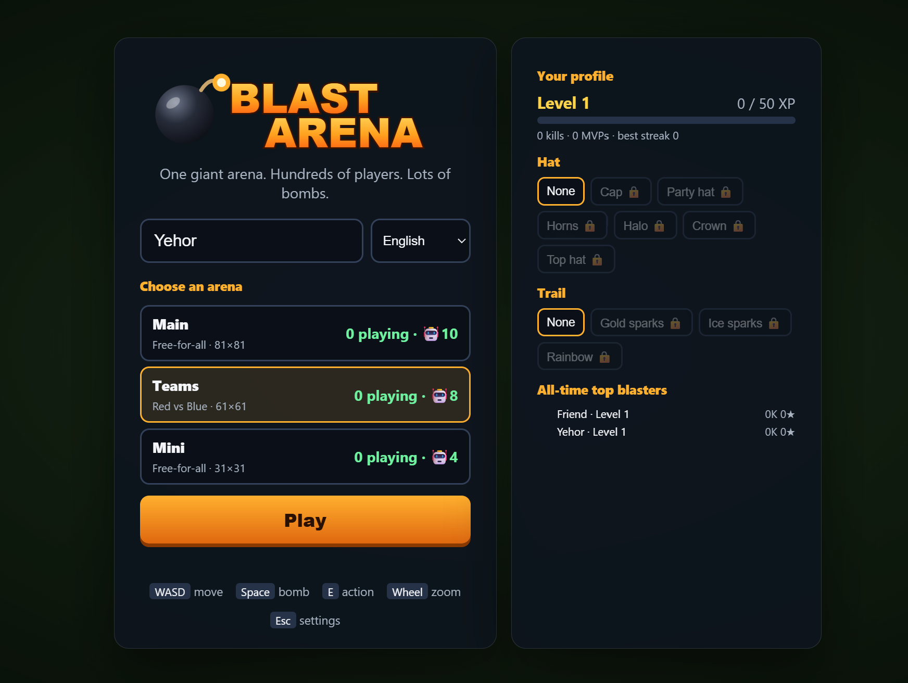
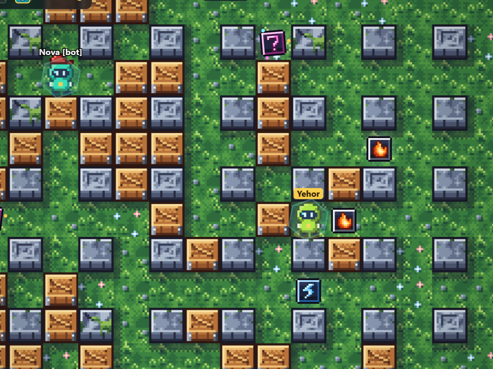
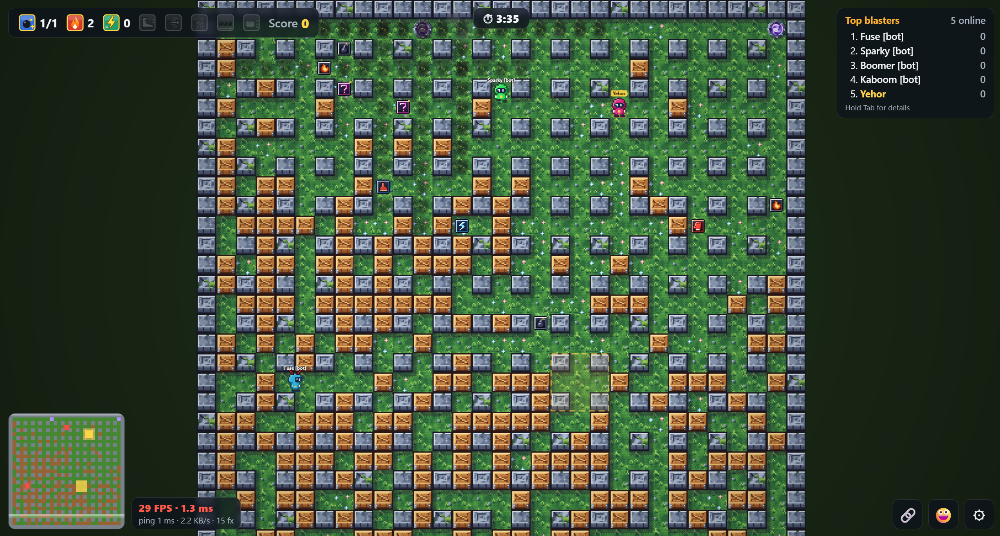

# Blast Arena





A massively multiplayer bomb-maze game for the browser. Pick an arena, drop bombs, blast crates, grab power-ups, hold the hills and blast each other.

- **Server:** Rust (Axum + WebSocket). Several arenas run side by side, with smart AI bots, rounds, teams and persistent player profiles in SQLite.
- **Client:** TypeScript on a plain HTML5 canvas (no framework, no bundler) with pixel art generated in code (or the classic hand-made SVG art) and procedural chiptune music (no audio files), in English, German, French, Spanish, Italian, Polish and Ukrainian. The language follows your browser and can be changed in the lobby or settings.

## Run

```bash
npm ci && npm run build   # compile the TypeScript client (client/) into static/js
cargo run --release
```

Open http://localhost:3000, pick an arena, enter a nickname and play.

The live server dashboard is at http://localhost:3000/dashboard.html, and Prometheus metrics at `/metrics`.

### Controls

| Input | Action |
|---|---|
| WASD / arrow keys | Move. Hold a second direction to queue a turn: hold Right, press Up early, and you turn at the next gap. |
| F / Enter | Drop a bomb. Press again while standing on it with the line bomb to lay a row. |
| Space | Jump over the stone pillar in front of you into the free cell behind it (0.4 s hop, 0.5 s cooldown; hold to keep hopping). You're above the fire while airborne, but can't steer, and a bomb pressed mid-air drops on landing. Crates and the map border can't be jumped. |
| E / Shift | Action: detonate remote bombs, or punch the bomb in front of you |
| Q | Use your gadget (land mine, rocket, swap, drone, drone swarm) |
| R | Use your ability (builder wall, clone, portal pair: press twice, dash) |
| C (hold) | Shake off a sticky bomb stuck on you (0.8 s) |
| X | Cancel a half-placed portal pair |
| 1–8 | Emotes (also the 😀 button) |
| Mouse wheel, `+` / `-` / `0` | Zoom in / out / reset |
| Tab (hold) | Leaderboard with kills and deaths |
| M / P / N / Esc | Mute / FPS / minimap / settings |
| Gamepad | Stick or d-pad moves, A bomb, B gadget, Y jump, X action, shoulder buttons zoom, right trigger ability, left trigger (hold) shake off a sticky bomb |
| Touch | Drag on the left to steer (floating joystick), bomb, jump (⤒), gadget (Q), ability (R) and action buttons, ✋ (hold, while a sticky bomb is on you), pinch to zoom |

The settings menu has music and sound volume, zoom, language, **art style**, mute, FPS, a colour-blind-friendly palette, high contrast, and a button to replay the tutorial. Art style is **Pixel art** by default: crisp 16×16 graphics generated in code, tiles in `client/pixelart.ts` and sprites in `client/pixelsprites.ts`, sharing `client/pixelkit.ts`. **Classic** brings back the original vector art. A short interactive tutorial runs on your first game.

The pixel art follows a few rules:
- **Lighting:** one light source from the top left, and colour ramps that shift hue (cool shadows, warm highlights).
- **Floors:** quiet and seamless, with variants per region, so players and items stand out.
- **Walls and crates:** raised blocks in 3/4 view, casting soft shadows onto the floor.
- **Regions:** each has its own walls (mossy stone, snow-capped blocks with icicles, limestone with gold inlays, obsidian with lava veins), and neighbouring regions blend along a wavy border.
- **Sprites:** everything you interact with has a dark outline.
  - **Bombs:** shaded iron spheres with a glint and a ground shadow. Pierce bombs are red with spikes, and remote bombs get a blinking antenna.
  - **Fire:** a fireball with white-hot, yellow, orange and red bands, flickering through three frames.
  - **Power-ups:** one family of bevelled tokens. The frame colour shows rarity and the glyph shows the effect.
  - **Players:** helmeted bombers in their team or player colour, with walk frames and pixel hats.
  - **Particles:** in pixel style they snap to the same pixel grid.

The **Tile Lab** at http://localhost:3000/tiles.html has three parts:
- a live scene animated by the game's renderer: walking players with hats, all three bomb types, a flickering explosion and power-ups
- a sample map of all four regions
- a sheet of every generated tile and sprite

You can reroll the tile seed there and compare with the classic art.

## Configuration

Command-line arguments; each has an environment-variable fallback. `cargo run --release -- --help` lists them.

| Argument | Env var | Default | Meaning |
|---|---|---|---|
| `--port` | `PORT` | `3000` | HTTP/WebSocket port |
| `--arena` | `ARENAS` | see below | An arena as `NAME:MODE:SIZE:BOTS`, mode `ffa`, `teams`, `royale` or `worms`. Repeat the flag, or comma-separate in the env var. |
| `--map-size` | `MAP_SIZE` | `81` | Size of the default main arena |
| `--bots` | `BOTS` | `10` | Bots in the default main arena |
| `--max-players` | `MAX_PLAYERS` | `256` | Player cap per arena, bots included |
| `--round-secs` | `ROUND_SECS` | `300` | Round length |
| `--map-seed` | `MAP_SEED` | random | Seed for the map layouts. Each start picks a fresh one and logs it; pass it back to replay the same maps (with the same arenas). |
| `--db` | `DB_PATH` | `blast.db` | SQLite file for profiles; `""` disables them |
| `--abilities` | `ABILITIES_CONFIG` | built in | JSON tuning of the six ability power-ups (charges, cooldowns, durations, radii, switches). Fields left out keep their defaults; `config/abilities.json` lists them all. An invalid file stops the server. |
| `--static-dir` | `STATIC_DIR` | built in | Serve the client from a directory instead. Release builds embed `static/` in the binary, so the executable runs on its own; debug builds serve `static/` from the source tree, so client edits show up on reload (keep `npm run watch` running to recompile the TypeScript). |
| `--public-url` | `PUBLIC_URL` | from the request | The site's public address (e.g. `https://blastarena.fun`) for link previews, the canonical link, `robots.txt` and `sitemap.xml`. Without it the address comes from each request (`Host`, or a proxy's `X-Forwarded-Proto` and `X-Forwarded-Host`). |
| `--log-level` | `LOG_LEVEL` | `info` | Log filter, e.g. `debug` or `info,blast_arena::net=debug`. `RUST_LOG` overrides it. |
| `--log-format` | `LOG_FORMAT` | `compact` | `compact`, `pretty`, or `json` (one object per line, for log collectors) |

Without `--arena` the server runs six arenas:
- `Main:ffa:<map-size>:<bots>`
- `Teams:teams:61:8`
- `Mini:ffa:31:4`
- `Royale:royale:81:15`
- `Worms:worms:61:6` (free-for-all with hunting worms)
- `Humans:ffa:51:0` (no bots: real players only)

Every start generates new maps. Each arena rolls its own layout from the map seed: a pillar pattern (classic grid, checkerboard, scattered, rooms of joined walls, open plazas, a winding maze with loops, or concentric rings with gates), optional mirror or rotational symmetry (walls, crates and spawn pockets alike, so no side is favoured), patchy crate cover, region placement, and how much ice, armour, conveyor belt and teleporting there is. The generator builds three candidate layouts and keeps the best by a quality score: spawn points spread over the whole arena, crates balanced between the quarters, few dead ends. The log shows the seed and a summary of each map with its score (`map generated`). To preview layouts without starting a server, run `cargo run --release --bin mapview -- --size 41 --count 5` (add `--open` for battle royale maps). Whatever the roll, the border is solid, no open cell is walled off, teleport pads come in pairs and there are plenty of safe spawn spots.

### Logging

The server logs with `tracing`. Records from the `log` crate are bridged into the same output, and the profile database logs that way.

| Level | Events |
|---|---|
| info | Startup and arena config; each player's join and disconnect, with the reason, duration and message counts; reconnects that resume a parked player; round results; tick stats every 10 s; shutdown |
| warn | Rate-limited or too-slow clients; dropped profile saves |
| debug | Handshake failures, socket errors, bot top-ups, profile loads and saves, and HTTP requests with their latency (`tower_http=debug`) |

Each session's lines carry a span with the arena, the peer address and the player id. Each game line carries its arena. Profile tokens are never logged.

```bash
RUST_LOG=info,blast_arena=debug cargo run --release -- --log-format json
```

## Gameplay

- **Bombs** explode in a cross after 2.5 s. Pillars stop the blast. Crates absorb it and break. Blasts set off other bombs in chain reactions.
- **Map regions**, each with its own look. Maps of 41×41 and up mix four to seven regions placed at random; smaller maps get a single random theme:

  | Region | Feature |
  |---|---|
  | Snow | Ice: let go and you keep sliding until you steer, hit something or leave the ice |
  | Desert | Conveyor belts that carry players and bombs |
  | Volcano | Armored crates that take two blasts |
  | Grass | Normal arena |

  Linked teleporter pads connect distant parts of the map.
- **Power-ups**, revealed from 25% of crates:

  | Power-up | Effect |
  |---|---|
  | +bomb | One more bomb at a time |
  | +range | Longer blast |
  | speed | Move faster |
  | kick | Walk into a bomb to send it sliding |
  | shield | 6 s of invulnerability |
  | pierce | Your blasts go through crates |
  | full fire | Maximum range |
  | remote | Your bombs wait for E (or 10 s) |
  | line bomb | Lay a row of bombs |
  | punch | Throw a bomb over obstacles |
  | ghost | Walk through crates for 6 s |
  | **atomic bomb** | Rare (1%). Your next bomb is a nuke: a 3.5 s fuse, then a shockwave that burns a disc of radius 6 over a few ticks. Pillars give no cover; crates (armored too) and items are vaporized. While it ticks, every cell it will burn is shown in red with a countdown, also on the minimap |
  | freeze | Your blasts leave ice on the floor for 8 s |
  | stomp | Landing a jump next to enemies stuns them for 1 s (no moving, jumping or bombs) |
  | **secret box** | A random outcome when opened (see below) |

- **Gadgets** are one-shot items used with **Q** (gamepad B). You hold the last kind you picked up, with a charge count in the HUD:

  | Gadget | Effect |
  |---|---|
  | land mines ×3 | Hidden from enemies (your team sees them). An enemy next to one sets it off half a second later; fire sets it off at once. |
  | rockets ×3 | Flies straight ahead at 20 tiles/s and explodes on whatever it hits |
  | swap ×2 | Trade places with the nearest enemy within 6 tiles |
  | drone | Flies over walls to the nearest enemy and drops up to 3 bombs on them |
  | drone swarm (1%) | Five drones, one bomb each, spreading over different enemies |

  Gadget bombs don't count against your bomb limit.

- **Abilities.** Four active abilities used with **R**: you hold one (another kind replaces it), with a few charges that come back one per cooldown. Two **bomb modifiers** change your next bombs (gas or sticky, never both). All of it is tuned in `config/abilities.json` (see `docs/ABILITIES.md`):

  | Ability | Effect |
  |---|---|
  | builder | A wall in the cell in front of you for 6 s (2 charges, 8 s cooldown, at most 2 standing). It blocks everyone (ghosts too), blasts and gas; a blast breaks it but stops there, a piercing one goes through. |
  | gas bombs ×2 | Instead of fire, a cross of gas (radius 2) for 4 s: 30% slower inside and for 0.5 s after; the screen edges go green. Fire touching the gas ignites it once: everyone in the cloud is hit by one burst. |
  | clone | A decoy that looks exactly like you replays your moves from 2 s ago for 5 s, fake bombs included (18 s cooldown). It can't hurt or pick anything up; a blast destroys it. You see a dashed ring under it. |
  | sticky bombs ×2 | Thrown 2 cells ahead; it sticks to the first enemy it touches (in flight or later on the ground) and rides along until its 3 s fuse runs out, through portals too. Hold **C** for 0.8 s to shake it off. |
  | portal pair | Press R to place a portal up to 3 cells ahead, again for its partner (5 s to do so). Players and sliding bombs go through, keeping direction; fire and gas don't. 12 s, then 20 s cooldown. A blocked exit refuses the trip. |
  | dash | 2.5 cells in 0.2 s in the direction you hold (6 s cooldown). Stops at walls and bombs, gives no protection from fire on the way, and may take one portal. |

- **Secret box.** Opening it gives one of:
  - any power-up
  - a jackpot: +1 bomb, +1 range and +1 speed
  - a curse: slowed down, no bombs, or reversed controls
  - bomb rain around you

  Secret boxes also appear on their own around the map.
- **Rounds** last 5 minutes. At the end, the MVPs and the winning team are shown, the MVP's profile gets a win and bonus XP, and scores reset.
- **Sudden death** fills the last minute of every round: the arena closes in, one ring at a time, towards a random centre. The next ring to close glows red; whoever is still in it when it turns to stone is crushed. Jumping over the closing wall at the last moment works. The arena reopens for the next round.
- **Map events** every minute or two: a **meteor shower** (marked impact zones, then blasts), a **blizzard** in snowy maps (everyone slows down, the minimap fogs over), a **lava surge** in volcanic regions (the ground glows, then burns), an **earthquake** in volcanic regions (the screen rumbles; fissures of fire open along volcano lanes after a short warning; tremors jolt resting bombs a cell in a random direction; when it stops a third of the volcano's crates break and may drop power-ups, some armor cracks and a few pillars crumble into rubble until the next round) and **reversed conveyors** in the desert.
- **Capture the flag** in the Teams arena: each team has a flag at its base. Walk over the enemy flag to take it and bring it to your base while your own flag is home: +5 points. Carriers can't jump or drop bombs. A carrier who dies drops the flag; touching your own dropped flag sends it home, and it goes home by itself after 15 s. You respawn near your base.
- **Battle royale** (the Royale arena): last player standing. Everyone starts spread over an open map and the whole map is safe; then the safe zone shrinks in five phases. Each phase first shows the next, smaller circle (white dashed line, also on the minimap) for a while, then the zone closes in on it. Outside the zone is the blue storm: the HUD shows how long you can stay in it (5 s early on, down to 1 s at the end), and time inside lets you recover. No respawns during a match: you watch the nearest survivor, and a new match starts 6 s after a winner is decided (+5 points), with everyone back and power-ups reset. Joining is open until the zone first moves. Royale maps are built to be run across: fewer crates, a crate-free road every 8 cells, and no pocket that can't be walked out of.
- **Worms** (the Worms arena): a free-for-all where giant worms crawl the lanes and hunt everyone, bots included. A worm is a head and a body that follows the head's path; it smells players up to 12 steps away along the lanes and crawls after the nearest one (yellow eyes while roaming, red while hunting, slower than you on foot). Touching any part of a worm on the ground eats you, unless you are shielded or jumping over it, and makes the worm a segment longer. Fire destroys the segments it touches: the end with the head crawls on, a cut-off piece of two or more segments becomes a worm of its own, and a worm that loses its head or is left too short dies. Ending a worm scores +1 for whoever's fire did it. New worms burrow out of the ground (a trembling mound, harmless for a second) away from players, about one per 550 cells of map. The minimap shows every worm. Worms maps are open, like Royale's, so worms and players have room to move. All the numbers are in `WormTuning` in `src/game/worms.rs`.
- **Death replay**: after you die, the last moments play again in slow motion from the killer's side until you respawn.
- **Scoring:**
  - +1 per kill.
  - +1 per worm you finish off (Worms arena).
  - +1 every 3 s you stand on a glowing **hill**; hills move each round.
  - The leader (5+ points) carries a **bounty** worth +2 extra.
  - Streaks of 3, 5, 8 and 12 kills are announced to everyone.
  - Blowing yourself up costs 1 point.
- **Team mode:** red versus blue, with balanced teams and no friendly fire.
- **Dying:**
  - You drop some power-ups.
  - While you wait 3 s to respawn, the camera follows whoever got you.
  - You come back with 2 s of spawn protection.
- If bombs box you in, you can kick one even without the kick power-up.

## Profiles, cosmetics, friends

- **Profiles:**
  - Your browser keeps a random profile token, with no sign-up. Kills, deaths, MVP wins, best streak and XP are saved in SQLite.
  - The lobby shows your level and an all-time top 20.
- **Cosmetics:** hats (cap, party hat, horns, halo, crown, top hat) and trails (gold, ice, rainbow) unlock as you level up.
- **Invites:** the 🔗 button copies an invite link (`?arena=…&near=<your id>`). Friends who open it spawn next to you.
- **Reconnecting:** a dropped connection reconnects automatically. The server keeps your score and power-ups for 30 s.

## AI bots

Each arena keeps its bots topped up, and humans take a bot's place when an arena is full. Bots follow the same rules as players.

How a bot plays:
- **Danger map.** The bots share a map of how many ticks remain before fire reaches each cell. It covers chain reactions and treats remote bombs as live.
- **Priorities:** escape first, then power-ups, attack spots, crate spots, or wandering. In team mode they don't target teammates.
- **Safe bombing.** A bot drops a bomb only with a robust way out. It avoids cells where others stand, and needs either two exits or a roomy safe area. It never chooses ice, a conveyor or a teleporter as a place to stop.
- **Remote bombs.** Once safe, a bot detonates its remote bombs.

## Deploy

```bash
DOMAIN=play.example.com docker compose up -d
```

- `Dockerfile` builds a small runtime image.
- `docker-compose.yml` puts it behind **Caddy**, which gets a TLS certificate automatically, so the game uses `wss://`.
- Profiles live in the `blast-data` volume.
- Caddy hides `/metrics` from the internet. Scrape `http://game:3000/metrics` from the Docker network instead.

Tested with Docker 29 and `docker-compose` 1.29 (in WSL), running `DOMAIN=localhost docker-compose up -d --build`:
- The image builds, and the server starts all arenas as a non-root user.
- Caddy serves the page and API over HTTPS, and redirects plain HTTP to HTTPS (308).
- Shared links show a preview card (Open Graph and X/Twitter tags, `static/og-image.jpg`, 1200×630). The page also has a description, a canonical link, schema.org `VideoGame` data, a web app manifest and icons, and the server answers `/robots.txt` and `/sitemap.xml`. `docker-compose.yml` sets `PUBLIC_URL` from `DOMAIN`.
- The WebSocket upgrade over `wss://` returns 101.
- `/metrics` returns 404 from outside but works inside the Docker network.
- The profile database is written to the `blast-data` volume.

## Benchmarks

```bash
# Network load test: real WebSocket clients wandering at random.
cargo run --release --bin bots -- --count 150

# In-process simulation: tick time and heap allocations per tick.
cargo run --release --bin simbench
```

Results on this machine:

| Measure | Result |
|---|---|
| Server tick, 200 bots + 150 clients encoding real snapshots (simbench) | about 3.4 ms (budget 50 ms) |
| Heap allocations per tick | about 0.06; 94% of ticks allocate nothing |
| Snapshot size per client per tick (simbench) | 383 bytes, down from 530 before delta encoding |
| Bandwidth per client, 150 connections (load test) | about 5.1 KB/s |
| Disconnects in the load test | 0 |

Prediction was also tested in the browser with every message delayed by 100 ms each way (212 ms ping):

| Measure | Result |
|---|---|
| First local movement after a key press | 14 ms |
| Prediction error over 171 reconciliations while turning constantly | 0.001 tiles on average, 0.005 at most |
| Corrections larger than a quarter tile | none |

Open the game with `?debug` to get `window.__blast` (state, predictor stats, network) in the browser console.

## How it scales

- **Several arenas.** Each arena is its own simulation task with its own bots. The lobby lists them with live player counts.
- **Compact binary protocol.**
  - Every binary WebSocket frame is a one-byte opcode plus fields in a fixed order: no keys, no type tags.
  - Integers are LEB128 varints (zigzag for signed values), so most values take one byte. A held input is 4–6 bytes.
  - Only the one-off welcome message keeps a MessagePack body.
  - Hot messages are written by hand straight into reusable buffers.
  - Client messages are parsed in place, without allocating.
- **Delta snapshots.**
  - Every input message also says which snapshot the client last decoded.
  - The server keeps a short history (32 ticks) of what it sent each client. It encodes only the players and bombs that are new, moved or gone since the snapshot the client confirmed.
  - A player who moved sends only the position change (usually 3 bytes), and a resting bomb sends nothing. The player's own state sends only the fields that changed, picked out by a bitmask. Empty sections cost nothing.
  - In a busy 12-bot test view a snapshot averages about 24 bytes, versus 141 with the old MessagePack deltas.
  - If that snapshot is too old or unknown, a full snapshot goes out instead. This happens, for example, right after joining.
  - Bombs carry their absolute detonation tick, so a resting bomb never counts as changed.
  - Tiles and items are sent once on join. After that only their changes go out, in a reliable world-delta stream. A skipped snapshot can't lose them.
- **Client-side prediction.**
  - Your browser runs the same movement code as the server, so your own moves show up instantly.
  - Each input carries a sequence number, and snapshots echo the last one the server applied.
  - The client then replays only the inputs the server hasn't seen yet.
- **Zero-copy, zero-allocation ticks.**
  - **Encoding.** Snapshots are encoded into a ring of large reusable buffers. Each client's message is a reference-counted slice handed to the socket without copying.
  - **No per-tick allocation.** The simulation and the bots work in persistent scratch memory, and their path searches never need clearing between uses.
- **Lock-free input.** Each connection writes its newest input into a few atomic counters that the game reads once per tick. There is no queue.
- **Area of interest.** Clients get entities within ±16×12 tiles by default. A client that zooms out can request up to ±26×18.
- **Back-pressure.**
  - A client that falls behind skips stale snapshots instead of building up a queue.
  - Only a client whose queue of important messages (kills, joins and the like) overflows is disconnected.
- **Client.**
  - Static tiles are cached in canvas chunks, redrawn only when a tile changes.
  - Snapshots live in a fixed-size ring buffer.
  - Effects use a preallocated particle pool.
  - An FPS / frame-time widget shows the result: 100–165 FPS at about 1 ms of work per frame in testing.

## Layout

```
src/main.rs           server entry point: arenas, routes, config
src/lib.rs            library root (crate blast_arena)
src/logging.rs        tracing subscriber setup and the log-crate bridge
src/net.rs            WebSocket sessions (arena choice, profile load, reader/writer)
src/api.rs            /api/arenas, /api/leaderboard, /api/profile, /api/stats, /metrics
src/db.rs             SQLite profiles, levels and cosmetic unlocks
src/metrics.rs        lock-free per-arena live stats
src/protocol.rs       binary wire format (opcodes, varints), encoder, arena ring
src/game/mod.rs       World state, config and constants
src/game/             tick (loop), roster (join/leave/spawn), movement, input, combat,
                      pickups, terrain, rounds, profiles, snapshot (AOI, encoding),
                      delta (delta snapshots), map, mapgen (random layouts), bomb,
                      items, player, testing, tests
src/game/link.rs      lock-free input slot and snapshot mailbox per client
src/game/abilities.rs ability power-ups: inventory, ability key, events, cleanup;
                      the mechanics in builder, gas, clone, sticky, portal, dash;
                      tuning in ability_config (config/abilities.json); tests in
                      ability_tests
src/game/ai.rs        server-side AI bots
src/game/worms.rs     the worms of the Worms arena (tuning, crawling, hunting,
                      blasts, respawns); tests in worm_tests
src/bin/bots.rs       network load tester
src/bin/simbench.rs   tick-time and allocation benchmark
src/bin/mapview.rs    prints generated maps as text, with their quality scores
static/index.html     lobby and game page; dashboard.html is the server monitor;
                      tiles.html is the Tile Lab
client/               the browser client in TypeScript: main, render, prediction,
                      particles, input, audio, i18n, tutorial, settings, net,
                      protocol, msgpack, dashboard, tilelab, state (shared types);
                      `npm run build` compiles it into static/js (generated, not
                      committed), `npm run watch` recompiles on save
static/assets/        SVG art
config/abilities.json default ability tuning (embedded in the binary)
docs/ABILITIES.md     design of the ability system and how to add one
Dockerfile, docker-compose.yml, Caddyfile   deployment
```

## License

Copyright 2026 Yehor Smoliakov <egorsmkv@gmail.com>.

Licensed under the [Apache License, Version 2.0](LICENSE). See [NOTICE](NOTICE).
